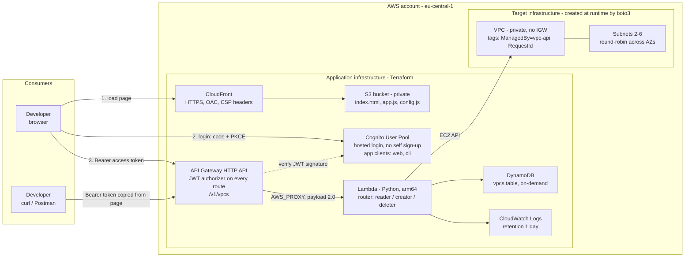
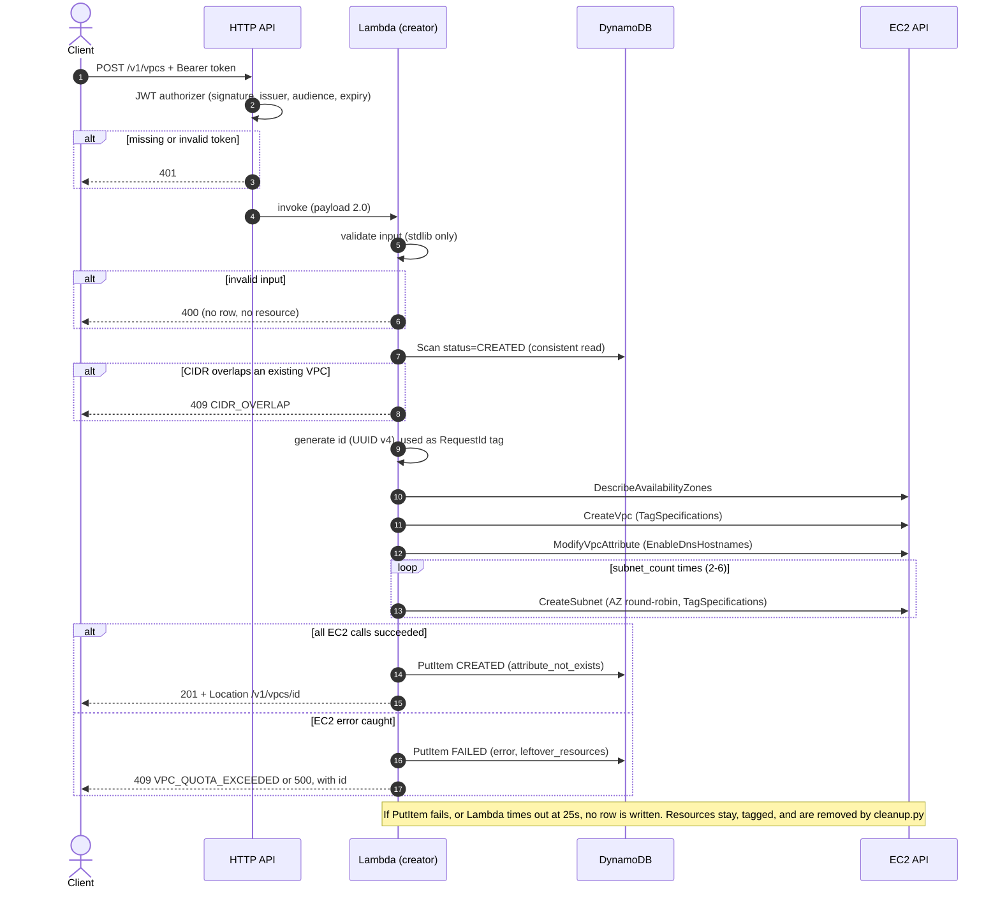
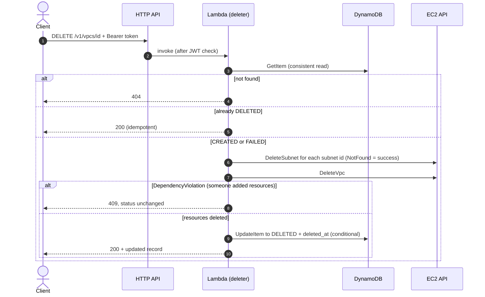

# VPC Provisioning API

A serverless API on AWS that creates private VPCs with multiple subnets, stores the
result and returns it on request. The API is protected by Cognito authentication;
authorization is open to every authenticated user.

- Code: Python (Lambda), standard library + the boto3 shipped with the runtime.
- Configuration: Terraform (one root module in `terraform/`).
- Contract: [openapi.yaml](openapi.yaml).

Contents:

1. [Overview and architecture](#1-overview-and-architecture)
2. [Design decisions](#2-design-decisions)
3. [Assumptions](#3-assumptions)
4. [Core vs extensions](#4-core-vs-extensions)
5. [If the consumer were external](#5-if-the-consumer-were-external)
6. [Security](#6-security)
7. [Deploy and teardown](#7-deploy-and-teardown)
8. [How to test](#8-how-to-test)
9. [Limitations and roadmap](#9-limitations-and-roadmap)

---

## 1. Overview and architecture

The API is an internal **"VPC vending"** service: a developer who needs a new VPC
creates it from a web page or with `curl`, without waiting for a platform team.



There are **two layers of infrastructure**, created and destroyed by different
mechanisms:

| | Application infrastructure | Target infrastructure |
|---|---|---|
| Contents | S3, CloudFront, Cognito, HTTP API, Lambda, IAM, DynamoDB, log group | VPCs and subnets |
| Created by | `terraform apply` | Lambda, through boto3, on `POST /v1/vpcs` |
| Deleted by | `terraform destroy` | `DELETE /v1/vpcs/{id}` or `scripts/cleanup.py` (by tag) |
| Source of truth | Local Terraform state | DynamoDB table + `ManagedBy` / `RequestId` tags |
| Tags | Provider `default_tags` (`Project`, `IaC`) | `ManagedBy=vpc-api` (used by IAM and cleanup) |

Terraform does not know about the VPCs created at runtime: they are deleted
**before** `terraform destroy` (see [Deploy and teardown](#7-deploy-and-teardown)).

### Create: `POST /v1/vpcs` (synchronous)



### Delete: `DELETE /v1/vpcs/{id}` (soft delete)



Reads (`GET /v1/vpcs`, `GET /v1/vpcs/{id}`) use DynamoDB only, never EC2.

### Repository layout

```
src/vpc_api/   Lambda code: handler (router), adapter, validation, topology,
               aws_clients, store, creator, reader, deleter
web/           Static page (index.html, app.js) and the config.js template
terraform/     All application infrastructure (single root module)
scripts/       tf_outputs.py, get_token.py, cleanup.py, env.py
tests/unit/    Unit tests (no AWS)
tests/e2e/     End-to-end test against the deployed stack (pytest -m e2e)
openapi.yaml   API contract (documentation)
```

---

## 2. Design decisions

### Architecture choices

- **HTTP API (v2), not REST API.** Cheaper, native JWT authorizer, `$default` stage
  with `auto_deploy` (no redeployment trap). REST API features (usage plans, API
  keys, request validation, private endpoints) are not needed. Validation is done in
  Python.
- **Synchronous creation.** Without NAT or IGW, creating a VPC and up to 6 subnets
  takes a few seconds (about 11 sequential AWS calls), well below the 30 s HTTP API
  limit. The Lambda timeout (25 s) is lower than the integration timeout, so the
  client never gets an API Gateway timeout while the function keeps creating
  resources. Step Functions and `202 Accepted` are the path for slow resources.
- **One Lambda function, three operations.** Routed on `routeKey`; each operation
  is its own module (`creator`, `reader`, `deleter`) on top of a shared adapter for
  the payload 2.0 event. Trade-off: a single IAM role holds the union of the
  permissions, mitigated by tag conditions (see [Security](#6-security)).
- **DynamoDB as the store.** One row per request with a confirmed result, written
  **once**: `CREATED` (VPC and all subnets created) or `FAILED` (EC2 error caught,
  with the error and the resources created so far). `DELETE` moves it to `DELETED`
  and keeps it as history. On-demand billing, partition key `id`, nothing else.
  `GET` reads from the store, not from live EC2 describes.
- **No `PENDING` state and no rollback.** Only a known result is written, once.
  Fewer states, writes and code branches mean fewer cases in `DELETE`, filters and
  tests. A rollback would itself be a failure point (deletes that fail,
  `DependencyViolation`, eventual consistency) that would also need handling.
  Resources created before an error stay in the account, are listed in
  `error.leftover_resources` and are removed with `DELETE`. Resources without a row
  (failed `PutItem`, Lambda timeout or crash) are found by their `ManagedBy` /
  `RequestId` tags and removed by `scripts/cleanup.py`. With an async flow,
  `PENDING` would be written before EC2 and a compensation step would be added.
- **Subnets computed by the service.** The caller gives `cidr_block`,
  `subnet_count` and an optional `subnet_prefix` (default `/24`); the service takes
  the first N consecutive blocks and spreads them round-robin over all available
  AZs, sorted by name. The region is a deployment decision, not a request field.

### Why Terraform

- Industry standard and cloud-agnostic (the assignment also mentions Azure).
- Explicit `plan` before every change; the IAM policy is readable in plain text.
- Terraform deploys **only the application infrastructure**. The VPCs requested
  through the API are created with boto3 at runtime: running Terraform from Lambda
  would mean a state per request, a binary in the package and slow executions.
- The "code in Python" requirement targets the API code; Terraform is the
  "config files" deliverable. The resulting infrastructure is fully serverless.

---

## 3. Assumptions

- Deployed in a personal AWS account, in `eu-central-1` (configurable to another EU
  region enabled by default with at least 3 AZs).
- The environment is ephemeral: `apply` -> tests -> cleanup -> `destroy`, then a
  full redeploy for the demo. URLs, user pool, clients and passwords change on every
  redeploy.
- Authorization is open to every authenticated user, as required: **every user sees
  every VPC**, and any user can delete any VPC created by the API. There are no
  roles, scopes or filters on `created_by`.
- The region is not part of the request body: VPCs are created in the region where
  the function runs.
- Default VPC quota: 5 per region, the default VPC uses one, so **4 VPCs** are
  available to the API. The default VPC is not deleted.
- Users are created by the administrator (Terraform); there is no self sign-up.

---

## 4. Core vs extensions

| Core (required) | Extensions (added) |
|---|---|
| `POST /v1/vpcs`: create a VPC with multiple subnets | `DELETE /v1/vpcs/{id}`: soft delete, idempotent |
| Store the result (DynamoDB) | Static web page (S3 + CloudFront + Cognito hosted login with PKCE) |
| `GET /v1/vpcs`, `GET /v1/vpcs/{id}`: retrieve from the store | End-to-end test (`pytest -m e2e`) with direct checks in EC2 |
| Authentication on every route (Cognito JWT), open authorization | Scripts: `env.py` (lifecycle), `get_token.py`, `cleanup.py` |
| Python code, config files, README | `openapi.yaml` |
| Automated setup (Terraform) | |

---

## 5. If the consumer were external

The current design trusts internal, authenticated users. For external consumers I
would change:

- **WAF** in front of the API (CloudFront + WAF, or a REST API with WAF), with
  managed rule groups and rate-based rules.
- **Rate limiting per client**: throttling on the stage, usage plans or WAF
  rate-based rules per user / client.
- **Authorization with tenancy**: no "open to all"; every record bound to a tenant,
  reads and deletes filtered by tenant, scopes per operation.
- **Machine-to-machine authentication** (client credentials with scopes) instead of
  shared user passwords.
- **Private API or custom domain**: a private REST API (interface endpoint) or an
  internal ALB if the consumers are in the network; otherwise a custom domain with
  the `execute-api` endpoint disabled.

---

## 6. Security

### Authentication vs authorization

- **Authentication** is mandatory: API Gateway verifies the Cognito access token
  (signature, issuer, audience, expiry) **before** invoking the function. Without a
  valid token the answer is `401` and the function does not run.
- **Authorization** is deliberately open to every authenticated user, as required.
  `403` is never used.

### What the IAM policy guarantees

The function has one role with one inline policy (no AWS managed policies).

| Guarantee | Mechanism |
|---|---|
| Never touches foreign VPCs (including the default VPC) | `ec2:ResourceTag/ManagedBy = vpc-api` on modify / delete, and on the parent VPC for `CreateSubnet` |
| Cannot "adopt" resources | `CreateTags` only with `ec2:CreateAction` (`CreateVpc`, `CreateSubnet`); no `DeleteTags` |
| Creates only tagged resources | `aws:RequestTag/ManagedBy = vpc-api` and a fixed list of tag keys (`aws:TagKeys`) |
| VPCs cannot become public | No Internet Gateway, NAT or route actions |
| Stays in its region | EC2 ARNs with region and account; `aws:RequestedRegion` on `DescribeAvailabilityZones` |
| Does not erase history | No `dynamodb:DeleteItem` (soft delete) |
| Does not escalate privileges | No `iam:*`, `iam:PassRole` or `sts:*` |
| Leaves no orphan log group | No `logs:CreateLogGroup`; the log group is managed by Terraform |

The subtle point: `CreateSubnet` is authorized on **two** resources, the new
subnet and the parent VPC. The request tag exists only on the subnet, so the policy
has one statement for the subnet (request tag) and one for the VPC (resource tag).

### Security layers

| Layer | Mechanism | What it stops |
|---|---|---|
| Transport | CloudFront and HTTP API are HTTPS only; HSTS | Clear-text traffic |
| Web page | Private S3 + OAC; CSP (`script-src 'self'`, `connect-src` only the API and Cognito, `frame-ancestors 'none'`); responses rendered with `textContent`, never `innerHTML` | Direct bucket access; XSS; clickjacking |
| Identity | Cognito without self sign-up; users created by the administrator; public web client without secret, code flow + PKCE + `state`; token in `sessionStorage` | Accounts created by anyone; code interception; CSRF on login |
| Token for scripts | Separate `cli` client with `ADMIN_USER_PASSWORD_AUTH` only (needs AWS credentials too); `ALLOW_USER_PASSWORD_AUTH` disabled everywhere | Password guessing directly against Cognito |
| API | JWT authorizer on every route; no `$default` route; CORS only for the CloudFront origin | Unauthenticated calls; forgotten public routes |
| Lambda invocation | `aws_lambda_permission` with `source_arn` = this API; no Function URL | Bypassing API Gateway |
| Lambda permissions | Tag conditions, region pinned, no IGW / NAT / routes, no `DeleteItem` | Touching foreign VPCs; public VPCs; erasing history |
| Input | Strict validation, unknown fields rejected, RFC 1918 only; raw AWS error messages never returned | Malformed requests reaching EC2; information leaks |
| Public repository | State, `*.tfvars` and output files git-ignored; credentials shared out of band; plain usernames, no email addresses anywhere in the stack | Leaking the account id, passwords or personal data |

### IAM trade-offs

1. **One role for reads and writes.** The `GET` routes run with create / delete
   permissions. The blast radius is limited by the tag conditions; the fix is
   splitting the function by privilege level.
2. **The guarantees live in the same account and the same role.** Whoever can edit
   the role can remove them. Real guarantees come from outside the role: SCPs or a
   permissions boundary.
3. **The tag is a trust boundary.** Anyone allowed to tag resources in the account
   can mark a resource `ManagedBy=vpc-api`. At organization level, an SCP should
   control who can set that tag.
4. **Eventual consistency of tag-based authorization.** `ModifyVpcAttribute` and
   `CreateSubnet` right after `CreateVpc` are authorized on the resource tag set at
   creation. There is no preventive retry on `UnauthorizedOperation` (it would hide
   real IAM errors); the end-to-end test exercises this path.

---

## 7. Deploy and teardown

### Requirements

- Terraform `>= 1.10, < 2.0`.
- Python 3.14 (the Lambda runtime is `python3.14`).
- An IAM user with access keys (not root), MFA enabled on its console access, in a
  named profile; `export AWS_PROFILE=...` / `$env:AWS_PROFILE = "..."`. The
  profile region should match `aws_region` (default `eu-central-1`), because
  `cleanup.py` uses the profile region.
- Recommended for a personal account: an AWS Budgets alert with a low threshold.

### One-time setup

```powershell
$env:AWS_PROFILE = "<profile>"
python -m venv .venv; .\.venv\Scripts\Activate.ps1
pip install -r requirements-dev.txt
```

On Linux / macOS / Git Bash: `export AWS_PROFILE=<profile>`, `python3 -m venv .venv`
and `. .venv/bin/activate` (Git Bash on Windows: `source .venv/Scripts/activate`).

Every variable has a default, so no `terraform.tfvars` is needed. The test users
are `demo-owner` and `reviewer` (plain usernames, no email); `aws_region`,
`project`, `demo_owner_username` and `reviewer_username` can be overridden in a
`terraform/terraform.tfvars` (see `terraform.tfvars.example`).
`requirements-dev.txt` is for the laptop only; nothing from it is packaged into the
Lambda function.

### Lifecycle

```powershell
python scripts/env.py up     # terraform init + terraform apply (interactive), then URLs and credentials
python scripts/env.py test   # pytest -m e2e
python scripts/env.py down   # cleanup.py --yes, then terraform destroy (interactive)
```

`env.py` only runs the existing commands in the right order. The individual
commands are:

```powershell
terraform -chdir=terraform init
terraform -chdir=terraform apply
terraform -chdir=terraform output                          # api_url, web_url, ...
terraform -chdir=terraform output -raw reviewer_password   # sensitive output
python -m pytest -m e2e
python scripts/cleanup.py --yes
terraform -chdir=terraform destroy
```

One `apply` creates everything: API, function, table, Cognito with the two test
users, the web page and its generated `config.js`. CloudFront makes `apply` and
`destroy` take a few minutes.

After a successful `apply`, `env.py up` prints `web_url`, `api_url` and the username
and password of both test users, in clear text. The password outputs stay
`sensitive` in Terraform, so they never appear in the `plan` / `apply` output;
nothing is written to disk. Clear the terminal before sharing your screen.

The Lambda package is written to `build/lambda.zip` during `plan` / `apply`.
`build/` is git-ignored and created automatically (by the `archive` provider and by
`env.py up`), so a fresh clone needs no manual step.

### Teardown order

**Delete the VPCs before `terraform destroy`.** Terraform does not know about the
VPCs created by the API, and after `destroy` the table (and `DELETE` through the
API) is gone. `env.py down` enforces the order and stops **before** `destroy` if
the cleanup could not delete everything (for example `DependencyViolation`), so the
leftovers can be resolved while the table still exists.

### Terraform state

The state is **local** (`terraform/terraform.tfstate`, git-ignored): one operator,
and an environment that lives only a few hours between `apply` and `destroy`. It
contains the account id, ARNs and the test user passwords, so it must never be
committed. With a team or CI, the path is an S3 backend with versioning and native
locking (`use_lockfile = true`), its bucket created by a separate bootstrap
configuration.

`.terraform.lock.hcl` is committed, so provider versions are reproducible.

### What changes on every apply after a destroy

The API URL, the CloudFront domain, the Cognito domain, user pool and client ids,
the users and their passwords. Nothing of this is hardcoded: the page gets its
`config.js` from Terraform and the scripts read `terraform output -json`.

### Operations

- **Reset a password:**
  `terraform -chdir=terraform apply -replace=random_password.reviewer`
  (or `random_password.demo_owner`). There is no "forgot password" by email: the
  users have no email address, so only the administrator resets passwords.
- **Lost state:** the application resources carry the `Project` and `IaC` tags from
  the provider `default_tags`; find them with Tag Editor (Resource Groups Tagging
  API) and delete them manually. The runtime VPCs are found and deleted by
  `python scripts/cleanup.py --yes` (it does not need Terraform).

---

## 8. How to test

### Web page

1. Open `web_url` (`terraform -chdir=terraform output web_url`).
2. **Log in**: you are redirected to the Cognito hosted login; the page never sees
   the password.
3. **Create** (name, CIDR, subnet count, optional subnet prefix), **List**,
   **Delete** (by id). The raw HTTP status and JSON response are shown.
4. **Copy access token** copies the token for `curl` or Postman.

The access token is valid for **one hour** and is not refreshed: after it expires,
log in again.

### curl

```bash
API_URL=<api_url>          # terraform -chdir=terraform output -raw api_url
TOKEN=<access token>       # copied from the page, or: python scripts/get_token.py --user demo-owner

curl -s -X POST "$API_URL/v1/vpcs" \
  -H "Authorization: Bearer $TOKEN" -H "Content-Type: application/json" \
  -d '{"name": "team-a", "cidr_block": "10.0.0.0/16", "subnet_count": 3}'

curl -s "$API_URL/v1/vpcs?limit=20" -H "Authorization: Bearer $TOKEN"
curl -s "$API_URL/v1/vpcs/<id>" -H "Authorization: Bearer $TOKEN"
curl -s -X DELETE "$API_URL/v1/vpcs/<id>" -H "Authorization: Bearer $TOKEN"
```

PowerShell: `$env:TOKEN = python scripts/get_token.py --user demo-owner`.
`get_token.py` uses the operator's AWS credentials and never writes the token to
disk.

### Postman

Import [openapi.yaml](openapi.yaml), set the `api_url` server variable and use the
copied token as a Bearer token.

### Error formats

Errors from the Lambda function:

```json
{
  "error": {
    "code": "VALIDATION_ERROR",
    "message": "Request validation failed.",
    "request_id": "<lambda request id>",
    "details": [{"field": "cidr_block", "message": "..."}]
  }
}
```

`details` is always a list (for `CIDR_OVERLAP` each entry also has
`conflicting_id`). `id` is added only when the error happened after EC2
provisioning started; the `FAILED` record can then be read with `GET`, and `id` is
also the `RequestId` tag of any resource left behind.

| HTTP | `code` | `message` |
|---|---|---|
| 400 | `INVALID_JSON` | Request body must be a JSON object. |
| 400 | `VALIDATION_ERROR` | Request validation failed. |
| 400 | `SUBNETS_DO_NOT_FIT` | The requested subnets do not fit in the VPC CIDR block. |
| 400 | `INVALID_ID` | The id must be a UUID. |
| 400 | `INVALID_NEXT_TOKEN` | The next_token is invalid. |
| 404 | `NOT_FOUND` | Resource not found. |
| 409 | `CIDR_OVERLAP` | The CIDR block overlaps an existing VPC created by this API. |
| 409 | `VPC_QUOTA_EXCEEDED` | The VPC quota for this region has been reached. |
| 409 | `DEPENDENCY_VIOLATION` | The VPC has resources that were not created by this API; remove them and retry. |
| 500 | `INTERNAL_ERROR` | Internal error. Use request_id to find details in the logs. |

Errors from API Gateway itself have a different body, `{"message": "..."}`:

| HTTP | When |
|---|---|
| `401` | Missing, invalid or expired token (the function is not invoked) |
| `404` | Route not defined in the API |
| `500` | The function timed out (25 s) or crashed (`Internal Server Error`); no record is written, leftovers are found by tag |
| `503` | Integration longer than 30 s; should not happen with a 25 s function timeout (observed behavior, not explicitly documented by AWS) |
| `429` | Only at the account-level default limit (no throttling configured) |

### Automated tests

```powershell
python -m pytest           # unit tests only (no AWS, no network)
python -m pytest -m e2e    # end-to-end, after apply, with AWS_PROFILE set
```

The end-to-end test covers: `401` without a token; `400` for a public CIDR; `404`
for an unknown id; the happy path (create `10.250.0.0/16` with 3 subnets, read,
list, read as the other user, check in EC2: tags, DNS hostnames, subnet CIDRs in 3
different AZs, `MapPublicIpOnLaunch = false`, no Internet Gateway); `409
CIDR_OVERLAP`; `DELETE` and the resources disappearing from EC2; idempotent second
`DELETE`. It deletes what it created through the API, even when it fails. Do not
use `10.250.0.0/16` manually while it runs.

### Manual quota scenario

The quota scenario is not automated (it consumes the whole quota):

1. 4 x `POST` with non-overlapping CIDRs -> `201` each.
2. 5th `POST` -> `409 VPC_QUOTA_EXCEEDED`, with `id`; `GET /v1/vpcs/{id}` shows a
   `FAILED` record with `aws_error_code = VpcLimitExceeded` and empty
   `leftover_resources`.
3. `DELETE` every record (the `FAILED` one is just marked `DELETED`).

### Cleanup script

```powershell
python scripts/cleanup.py                              # dry run: account, region, resources
python scripts/cleanup.py --yes                        # delete everything tagged ManagedBy=vpc-api
python scripts/cleanup.py --request-id <id> --yes      # only the resources of one request
```

The script only touches EC2 (subnets, then VPCs), never DynamoDB. Without a filter
it is meant for **right before `destroy`**; during a test cycle use `DELETE`
through the API for records that exist, and `--request-id` for orphans (otherwise a
record stays `CREATED` for a VPC that no longer exists). Resources added by someone
else are never deleted: a `DependencyViolation` is reported, the script continues
and exits with code `1`.

---

## 9. Limitations and roadmap

### Limitations

- **CIDR overlap check:** a `Scan` on every `POST` (fine at low volume, does not
  scale); a race window between the check and the write (the duration of the EC2
  calls), so two concurrent overlapping requests can both succeed; VPCs created
  outside the API (console, other IaC, the default `172.31.0.0/16`) are not seen.
  `FAILED` and `DELETED` records do not block a CIDR.
- **Names are not unique.**
- **Uneven AZ spread:** 4 or 5 subnets on 3 AZs give 2/1/1 or 2/2/1. AZ names map to
  different physical zones in other accounts (`availability_zone_id` is stored).
- **Default security group untouched** (CIS EC2.2 would require it to deny all
  traffic); default NACL and main route table untouched.
- **Eventual consistency:** `InvalidVpcID.NotFound` right after `CreateVpc` is not
  retried; it ends as a `FAILED` record with the VPC in `leftover_resources`
  (`DELETE`, then `POST` again).
- **Orphan resources:** a Lambda timeout or crash, a failed `PutItem`, a read
  timeout on a create call (the id never reaches the code) or a duplicate created by
  a boto3 retry after a lost response leave resources without a record. They are
  tagged and removed by `cleanup.py`.
- **No throttling and no access logs:** an authenticated user can send any number of
  requests (the VPC quota caps `POST`); requests rejected by API Gateway (`401`) are
  not logged anywhere.
- **Static region list** in the `aws_region` validation, maintained by hand.
- **List order is unspecified** (DynamoDB `Scan`); pages can be short or empty
  while `next_token` is set.
- **Token lifetime:** one hour, no refresh on the page.
- **Open authorization:** any authenticated user can delete any VPC created by the
  API.

### Roadmap

In order:

1. CI in GitHub Actions (`terraform fmt`, `validate`, `tflint`, `checkov`, `ruff`,
   `pytest`), then CD with OIDC.
2. Static analysis of the IAM policy with IAM Access Analyzer.
3. Machine consumers (pipelines, portal) with machine-to-machine authentication.
4. Remote Terraform state in S3 (versioning + native locking, bootstrap
   configuration), required for CI or a team.
5. Deploy from CI with OIDC and a reviewed `plan -out`.
6. IAM Identity Center instead of access keys.
7. MFA, and test users created outside the Terraform state.
8. boto3 `adaptive` retry mode and an explicit retry on `*.NotFound`.
9. Throttling on the stage / WAF rate-based rules per user.
10. Access logs and alarms.
11. A `PENDING` state (needed for the async flow).
12. Rollback / automatic compensation (a Step Functions step).
13. Periodic reconciliation between tags and the table (finds unregistered
    resources).
14. TTL / PITR on the table.
15. Connectivity: gateway endpoints for S3 / DynamoDB, IGW + custom route tables for
    public subnets, NAT, Transit Gateway + centralized egress.
16. Subnet customization (explicit list, chosen AZs, public / private mix).
17. Sorting by `created_at` (GSI).
18. Splitting the function by privilege level (+ reserved concurrency on
    `creator`).
19. A strictly internal API (private REST API or internal ALB).
20. WAF (CloudFront + WAF).
21. Custom domain.
22. Step Functions.
23. Amazon VPC IPAM.
24. Multi-account.
25. GSI on `created_by`.
26. Drift reconciliation.
27. Idempotency keys.
28. Machine-to-machine authentication (client credentials).
29. SCPs / permissions boundary (IAM guarantees outside the role, including who can
    set the `ManagedBy` tag).
